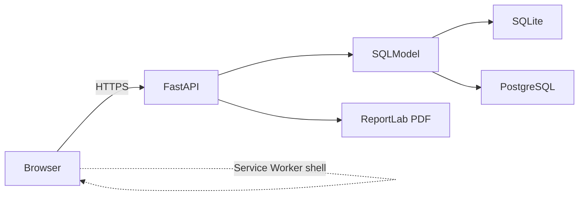
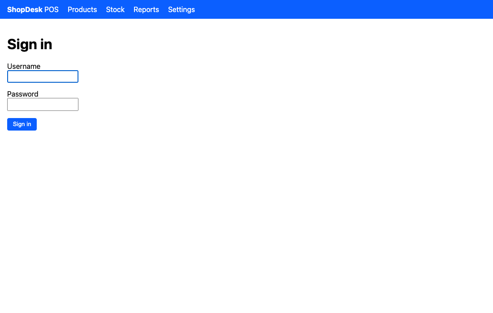
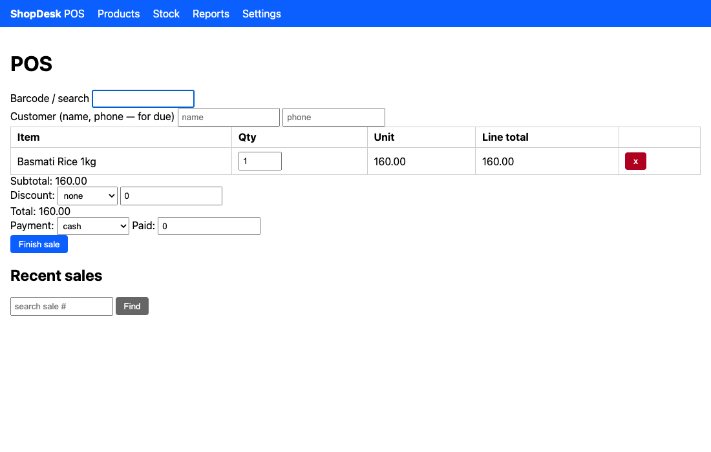
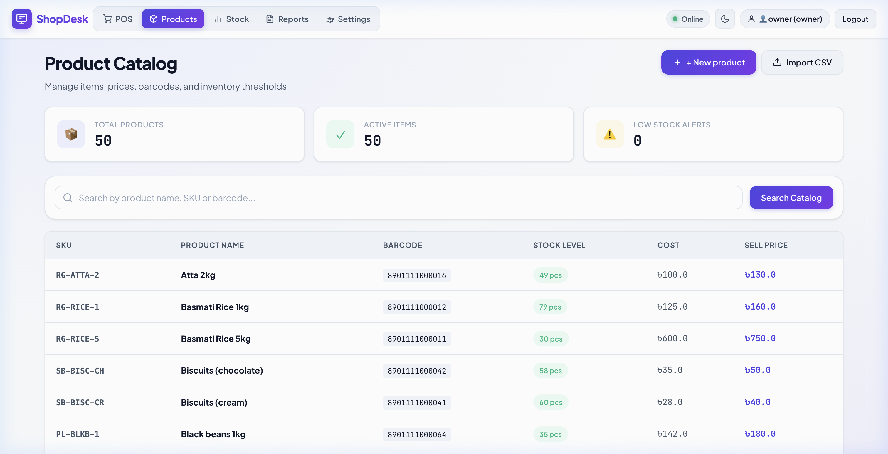
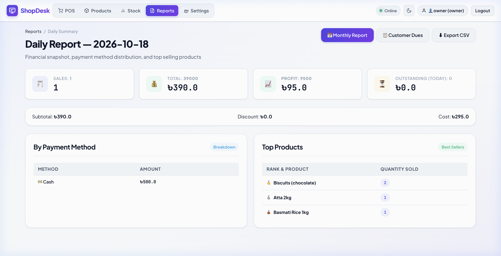
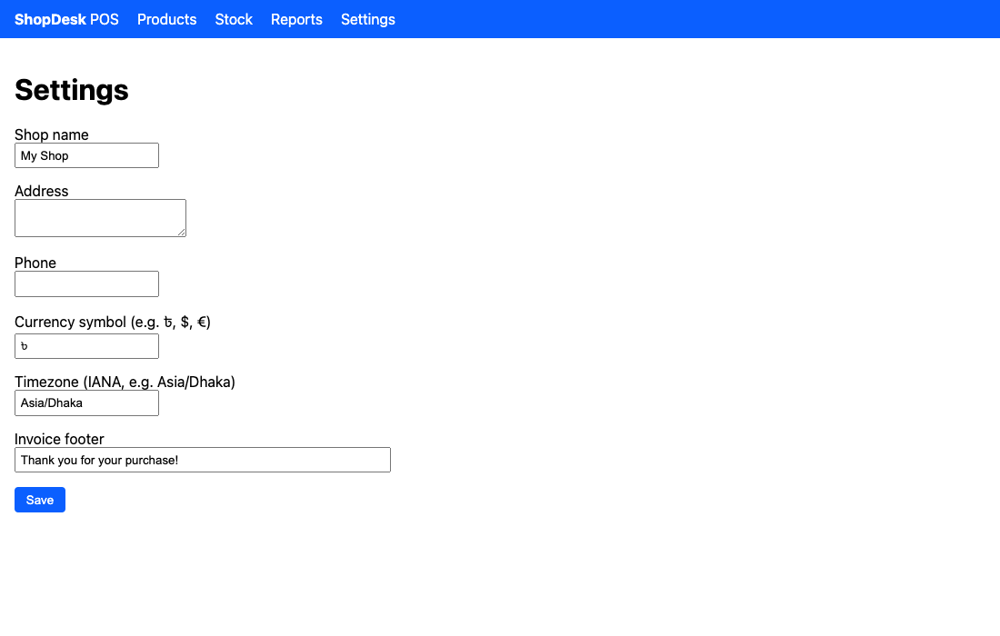

# ShopDesk

A small, fast point-of-sale and inventory app for neighborhood shops.

- Catalog with categories, CSV import, search
- Stock ledger with reason tracking; can never go negative
- POS with barcode scanner support, discounts, three payment methods
- PDF invoices with Bangla support
- Daily & monthly reports, profit, dues, CSV export
- **Offline POS** — the POS screen works without a network, sales are
  queued in the browser and synced when the connection returns
- Argon2 passwords, signed sessions, CSRF, login rate-limit
- Backups + restore, idempotent seed, settings page

The contract is in [SCOPE.md](SCOPE.md). Anything not listed there is
intentionally out of scope.

## Architecture



The browser is a thin vanilla-JS app (no framework). The offline queue
sits in IndexedDB; the service worker caches the app shell. The
server-side renders Jinja2 templates and reportlab PDFs.

## Quick start (development)

```bash
# Clone, set up Python 3.12, install.
python3.12 -m venv .venv
source .venv/bin/activate
pip install --upgrade pip
pip install -e '.[dev]'

# Optional: install Playwright browsers for the e2e tests.
python -m playwright install chromium

# Environment.
cp .env.example .env
# (the defaults in .env.example work for local development)

# Create the first owner.
python scripts/create_owner.py owner owner123

# Optional: seed demo data (50 products, 3 customers).
python scripts/seed.py

# Run the app.
uvicorn app.main:app --reload
```

Open <http://127.0.0.1:8000>. Log in as `owner` / `owner123`.

## Screenshots

| | |
|---|---|
|  |  |
|  |  |
|  | |

## Testing

```bash
# Unit + integration tests on SQLite.
pytest

# The e2e tests start a real uvicorn server and drive it with chromium.
# They are skipped automatically if the Playwright browser is missing.
pytest tests/test_offline_e2e.py tests/test_e2e_m7.py

# Lint.
ruff check .
```

## Deployment

See [DEPLOY.md](DEPLOY.md) for step-by-step instructions covering
Render (managed) and Docker Compose on a VPS.

After deployment, verify with:

```bash
BASE=https://your.shop.example ./scripts/smoke_test.sh
```

## Backups

```bash
# Back up to ./backups/
./scripts/backup.sh

# Restore (will overwrite the existing DB).
./scripts/restore.sh ./backups/shopdesk-sqlite-20251024T103000Z.db.gz
```

Works on SQLite (`sqlite3 .backup`) and Postgres (`pg_dump`). Archives
are gzipped.

## File map

```
app/                  # the FastAPI app
  main.py             # app factory, /health
  auth.py             # argon2, sessions, CSRF
  config.py           # pydantic-settings, env
  db.py               # engine + session
  deps.py             # FastAPI dependencies (login, owner, csrf)
  models/             # SQLModel tables
  money.py            # integer-minor-units money math
  routers/            # one file per area
  sales.py            # transactional sales, gap-free numbers
  stock_ops.py        # atomic stock decrement
  reports.py          # daily, monthly, profit, CSV
  invoices.py         # reportlab PDF
  settings_store.py   # DB-backed shop settings

app/static/
  sw.js               # service worker (offline shell)
  manifest.webmanifest
  icons/icon-{192,512}.png
  js/pos/
    index.js          # POS UI
    offline.js        # IndexedDB queue

app/templates/        # Jinja2 (Jinja2Templates)
scripts/              # CLI utilities
tests/                # pytest
docs/screenshots/     # README images
```

## License

The bundled Noto Sans Bengali font is licensed under the SIL Open Font
License; see `assets/fonts/OFL.txt`. The rest of the source is released
under the MIT license unless stated otherwise.

## Hardening

Security review verified (tested 3x,
zero lint issues, all SCOPE.md acceptance criteria covered).