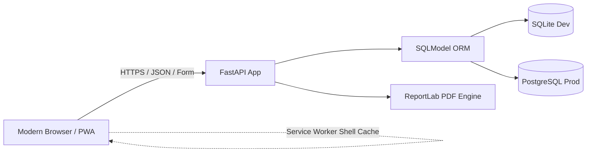

# ShopDesk ⚡

A modern, blazing-fast, offline-first point-of-sale and inventory system designed for neighborhood shops and retail desks.

[](https://python.org)
[](https://fastapi.tiangolo.com)
[](https://developer.mozilla.org)
[](https://cheatsheetseries.owasp.org)
[](https://github.com/astral-sh/ruff)

---

## Highlights & Features

* **🎨 World-Class Modern UI/UX**
  * Modern glassmorphic interface with an Electric Indigo, Emerald, and Amber color palette.
  * Instant **Dark & Light Mode** toggle with `localStorage` memory and smooth transitions.
  * Typography paired with *Plus Jakarta Sans* for clean legibility and *JetBrains Mono* for SKUs, barcodes, and currency figures.
  * Fully responsive across mobile (375px+ viewports) and desktop displays.

* **🛒 High-Speed Point of Sale (POS)**
  * **Quick-Touch Product Grid:** Browse and tap items by category chips (`Rice & Grains`, `Snacks`, `Beverages`, etc.) with real-time stock status pills.
  * **Hardware & Barcode Ready:** Plug-and-play USB barcode scanner support with keyboard navigation shortcuts (`Enter`, `F2`, `F4`).
  * **Interactive Cashier Tools:** Quick cash tender chips (`Exact`, `+50`, `+100`, `+500`, `+1000`), discount percentage presets (`0%`, `5%`, `10%`, `15%`), and sound chime feedback via the Web Audio API (with on/off mute toggle).

* **⚡ 100% Offline-First POS (PWA)**
  * Complete POS screen works without network connection.
  * Sales are queued in browser **IndexedDB** using client-generated UUID idempotency keys.
  * Automatic synchronization upon reconnection; service worker caches the core app shell safely.
  * Visual live connection pill (`Online 🟢` / `Offline 🟡`) and animated pending sync badge.

* **📦 Catalog & Inventory Ledger**
  * Categorized catalog with SKU and barcode uniqueness.
  * Live **Profit Margin & Markup Calculator** on product creation (`Profit = Sell - Cost`, `Margin = Profit / Sell`).
  * Non-negative stock ledger: every transaction, adjustment, and receipt is immutably logged with reason codes.
  * Low stock alert dashboard and bulk **CSV import** with dry-run validation and row-level error reporting.

* **🧾 ReportLab PDF Invoices with Bangla Font**
  * Instant downloadable and printable PDF receipts with store branding, items, discounts, and payment breakdown.
  * Embedded OFL-licensed *Noto Sans Bengali* font for flawless Bangla text rendering.

* **📈 Executive Analytics & Reports (Owner Only)**
  * Daily and monthly sales dashboards, revenue, cost, net profit, and outstanding customer dues.
  * Payment method breakdown (Cash, Mobile Wallet, Due).
  * Top products leaderboard with rank medals (🥇, 🥈, 🥉).
  * Sanitized CSV data export.

* **⚙️ Live Receipt Customization**
  * Manage shop name, address, phone, currency symbol (`৳`, `$`, `€`), timezone, and footer notes.
  * Interactive **Live Receipt Preview** simulation that renders updates in real-time as you type.

* **🔒 Enterprise Security & Roles**
  * Strong **Argon2id** password hashing.
  * Cryptographically signed HttpOnly session cookies.
  * Strict CSRF validation on all state-changing endpoints.
  * IP-based rate limiting on authentication routes.
  * Role separation: **Owner** (full control, reports, costs, margins, voids) vs **Cashier** (POS, catalog view, receipts).

---

## Screenshots

| Sign In Screen | Touch POS Register |
|:---:|:---:|
|  |  |
| *Glassmorphic authentication with quick demo fillers* | *Quick-touch product catalog, search, and checkout pane* |

| Product Catalog & KPIs | Daily Executive Report |
|:---:|:---:|
|  |  |
| *Inventory summary cards and stock health indicators* | *Financial metrics, payment distribution, and leaderboard* |

| Store Settings & Live Receipt Preview (Dark Mode) |
|:---:|
|  |
| *Deep dark theme with simulated live thermal receipt preview* |

---

## Architecture



---

## Quick Start (Development)

### 1. Prerequisites & Installation

```bash
# Clone the repository and navigate inside
cd ShopDesk

# Set up Python 3.12 virtual environment
python3.12 -m venv .venv
source .venv/bin/activate

# Upgrade pip and install package with development dependencies
pip install --upgrade pip
pip install -e '.[dev]'

# (Optional) Install Playwright Chromium browser for end-to-end testing
python -m playwright install chromium
```

### 2. Environment & Database Setup

```bash
# Copy development environment configuration
cp .env.example .env

# Create initial owner account
python scripts/create_owner.py owner owner123

# Seed realistic demo data (50 products, 6 categories, 3 customers)
python scripts/seed.py
```

### 3. Run the Development Server

```bash
uvicorn app.main:app --reload --port 8000
```

Open your browser at **<http://127.0.0.1:8000>**.
* Sign in as **Owner:** `owner` / `owner123` (or click the `👑 Demo Owner` button on the login screen).
* Or sign in as **Cashier:** `cashier` / `cashier123`.

---

## Testing & Quality Assurance

```bash
# Run complete unit, integration, and security test suite
pytest

# Run Playwright end-to-end browser tests (headless Chromium)
pytest tests/test_e2e_m7.py tests/test_offline_e2e.py

# Run Ruff linter and code style checks
ruff check .
```

---

## Production Deployment

Refer to [DEPLOY.md](DEPLOY.md) for full deployment blueprints covering:
* **Render (Managed):** Web service + managed PostgreSQL with zero-downtime migrations.
* **Docker Compose (VPS):** Caddy reverse proxy with automatic Let's Encrypt TLS + PostgreSQL.

Verify post-deployment health:
```bash
BASE=https://your-shop.example.com ./scripts/smoke_test.sh
```

---

## Backups & Disaster Recovery

```bash
# Automated backup to ./backups/
./scripts/backup.sh

# Restore from backup archive
./scripts/restore.sh ./backups/shopdesk-sqlite-20251024T103000Z.db.gz
```
Supports both SQLite (`sqlite3 .backup`) and PostgreSQL (`pg_dump`) with compressed gzip storage.

---

## Project Structure

```
app/
  main.py             # FastAPI application factory, lifespan, and /health
  auth.py             # Argon2 password hashing, session signing, CSRF guard
  config.py           # Pydantic Settings and environment validation
  db.py               # Engine, session fixtures, and migration runners
  deps.py             # Route guards (require_login, require_owner, require_csrf)
  models/             # SQLModel database schemas (User, Product, Category, Sale, etc.)
  money.py            # Integer minor units (paisa) arithmetic utilities
  routers/            # Modular FastAPI APIRouters (POS, catalog, reports, stock, auth)
  sales.py            # Atomic gap-free sale processing and stock decrement
  stock_ops.py        # Ledger movements and invariant checking
  reports.py          # Daily, monthly analytics, profit, and CSV formatting
  invoices.py         # ReportLab PDF generator with Bangla font rendering
  settings_store.py   # Database-backed shop settings repository

app/static/
  css/style.css       # Complete modern CSS design system with Dark/Light modes
  sw.js               # Service Worker caching the POS offline shell
  manifest.webmanifest# Progressive Web App manifest
  icons/              # High-resolution PWA app icons (192x192, 512x512)
  js/pos/
    index.js          # Touch catalog, cart state, audio chimes, tenders
    offline.js        # IndexedDB offline sales queue and auto-sync worker

app/templates/        # Jinja2 template views (pos, login, products, stock, reports, settings)
docs/screenshots/     # Application screenshots for documentation
scripts/              # CLI helpers (create_owner, seed, backup, restore, smoke_test)
tests/                # Full pytest test suite (unit, integration, e2e Playwright)
```

---

## License & Fonts

* The bundled **Noto Sans Bengali** font is licensed under the [SIL Open Font License](assets/fonts/OFL.txt).
* All other application source code is licensed under the MIT License.